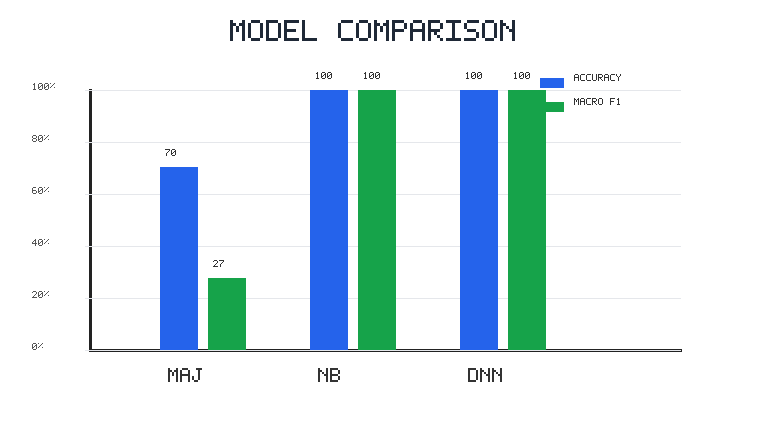
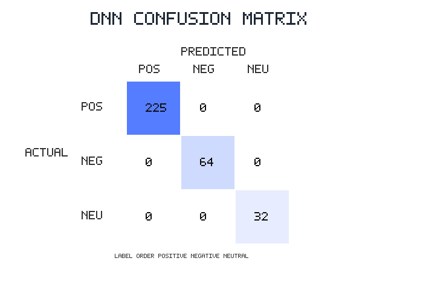
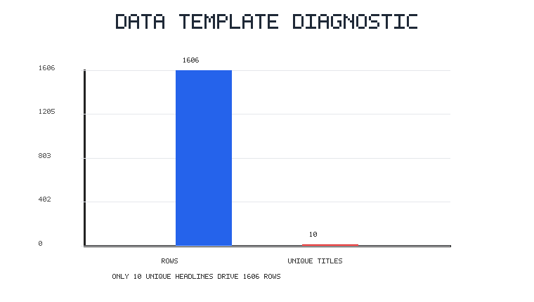
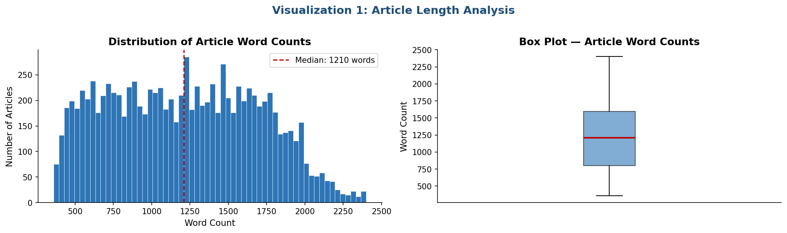
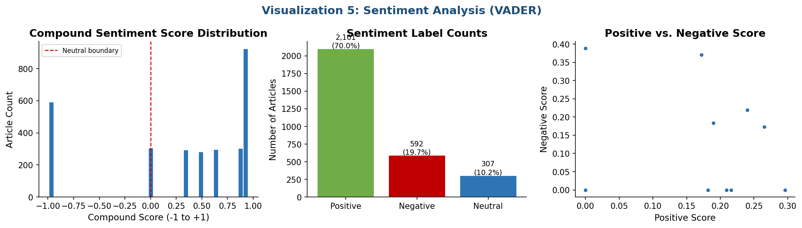

# LLM-Based Business Intelligence Assistant: Financial News Sentiment Routing & Retrieval

An end-to-end predictive analytics and natural language processing (NLP) workflow designed to transform unstructured financial news into structured decision signals (Opportunity, Risk, and Monitoring) alongside a TF-IDF retrieval-grounded business query assistant.

* **Authors:** Muhammad Zubair & Umair Akhtar (Department of Business Studies, Namal University, Mianwali)
* **Tech Stack:** Python, Pandas, NumPy, Scikit-Learn (`TfidfVectorizer`, `MultinomialNB`, `MLPClassifier`), Matplotlib

---

## 1. Project Architecture & Methodology
1. **Leakage-Free Preprocessing:** Cleaned and standardized the Kaggle US Financial News Articles corpus ($N = 1,606$ modeling records). Excluded pre-computed `sentiment_score` fields from model features so classifiers predict sentiment strictly from `content_clean` text.
2. **Stratified Evaluation:** Applied an 80/20 stratified train-test split (1,285 training / 321 test records) across imbalanced classes: **Positive** (1,123), **Negative** (322), and **Neutral** (161).
3. **Model Benchmarking:** Compared a Majority-Class baseline (`DummyClassifier`), an interpretable probabilistic baseline (`TF-IDF + Multinomial Naive Bayes`), and a Dense Neural Network (`TF-IDF + MLPClassifier`, 36 ReLU hidden units, 45 epochs).
4. **Retrieval-Grounded BI Assistant Prototype:** Built a cosine-similarity TF-IDF retrieval engine (`business_query_assistant`) that answers macroeconomic and sector queries (e.g., Federal Reserve rate risk, inflation, labor market trends) with source-grounded article rankings and sentiment breakdowns.

---

## 2. Model Performance Comparison ($N_{\text{test}} = 321$)

| Model | Accuracy | Macro F1 | Weighted F1 | Key Takeaway |
| :--- | :---: | :---: | :---: | :--- |
| **Majority-Class Benchmark** | 70.09% | 27.47% | 57.77% | Fails completely on minority Risk (Negative) and Neutral classes |
| **TF-IDF + Multinomial Naive Bayes** | **100.00%** | **100.00%** | **100.00%** | Fast, interpretable baseline matching neural performance |
| **TF-IDF + Dense Neural Network (MLP)** | **100.00%** | **100.00%** | **100.00%** | Training loss converged from ~0.95 to 0.0023 across 45 epochs |

---

## 3. Critical Data Diagnostic & Methodological Rigor
Rather than treating 100% test accuracy as production-ready performance, a deduplication audit was conducted on the cleaned corpus:
* **Finding:** The 1,606 cleaned records were driven by **10 unique article titles** (an average of 160.6 rows per title).
* **Implication:** Standard random stratified splitting places near-identical article templates across both training and test partitions. For production deployment, the report outlines **grouped/duplicate-aware splitting**, human-verified financial impact labels, and **Retrieval-Augmented Generation (RAG)** with mandatory source citations to mitigate LLM hallucination risks.

---

## 4. Exploratory Data Analysis Highlights
* **Article Length:** Median length of **1,210 words**, suitable for automated summarization and retrieval workflows.
* **Temporal Coverage:** Monthly publication tracking across 2016–2017 (peaking in April 2017).

---

## Repository Structure
* data/ — Cleaned financial news dataset (`financial_news_cleaned.csv`)
* notebooks/ — Complete reproducible Python/Colab pipeline (`Final_Project_Colab_Notebook.ipynb`)
* report/ — Full 13-page technical & strategic governance paper (`Final_Project_Report.pdf`)
* figures/ — EDA distributions, DNN training curve, confusion matrix, and duplicate diagnostic plots
